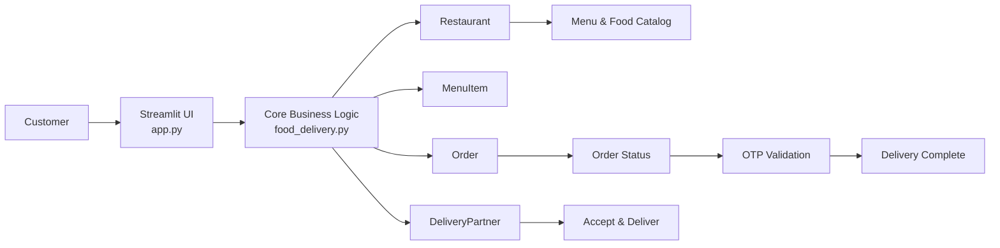

# 🍔 Food Delivery System

<div align="center">
  
  
  
  
</div>

A smart, interactive food delivery simulation built with Python and Streamlit. This project models the core workflow of a food ordering platform, including customer registration, wallet top-up, menu browsing, order placement, delivery-partner acceptance, and OTP-based order completion.

## 🚀 Project Overview

This application demonstrates a realistic food delivery lifecycle in a compact and beginner-friendly way. The project uses object-oriented programming to represent entities such as customers, restaurants, menu items, delivery partners, and orders.

It is designed as:
- a learning project for Python developers,
- a demo application for order flow simulation,
- and a starting point for building a larger food delivery system.

## ✨ Features

- 🧑‍💼 Customer creation and profile management
- 💰 Wallet balance management with top-ups
- 🍽️ Restaurant menu display with veg/non-veg labeling
- 🛒 Order placement with automatic bill calculation
- 📦 GST and packaging fee integration
- 🚚 Delivery partner assignment and availability tracking
- 🔐 OTP verification for final delivery confirmation
- 📊 Order status updates across the lifecycle
- 🖥️ Interactive UI powered by Streamlit
- 🧪 Console-based demo workflow for quick testing

## 🏗️ System Architecture



### Core business flow

1. A customer creates an account and adds money to the wallet.
2. The restaurant menu is displayed.
3. The customer selects items and places an order.
4. The system creates an order with a generated OTP.
5. A delivery partner accepts the order.
6. The customer or order flow validates the OTP.
7. The delivery is marked complete and the partner becomes available again.

## 📁 Repository Structure

```text
Food_Delivery/
├── app.py                     # Streamlit web interface for the food delivery app
├── food_delivery.py          # Core object-oriented logic and models
├── demo (1).py               # Sample execution script for the project flow
├── Food_Delivery_System.ipynb # Jupyter notebook implementation/demo
├── README.md                 # Project documentation
├── requirements.text         # Python dependencies (named with a .text extension)
└── .gitignore                 # Git ignore rules (if present in repo)
```

## 🧩 Main Modules and Responsibilities

### `app.py`
This is the interactive web application built with Streamlit. It provides a user-friendly interface for:
- entering customer details,
- topping up wallet balance,
- selecting restaurant items,
- placing orders,
- assigning delivery partners,
- and verifying OTP delivery completion.

### `food_delivery.py`
This file contains the business logic and class definitions used by the application. The major entities are:

- `User` — abstract base class for shared wallet and notification behavior
- `Customer` — customer profile, wallet, and orders
- `DeliveryPartner` — delivery lifecycle and availability tracking
- `Restaurant` — menu management
- `MenuItem` — food item representation
- `Order` — order status, billing, and OTP verification

### `demo (1).py`
This script demonstrates the project’s core workflow in a simple console-based format. It helps test the classes and validations without the UI layer.

### `Food_Delivery_System.ipynb`
This Jupyter notebook contains a notebook-based model of the same food delivery scenario, useful for learning and demonstration.

## 🛠️ Tech Stack

- Python 3.x
- Streamlit for UI
- Object-Oriented Programming (OOP)
- Jupyter Notebook for experimentation and demonstration

## ⚙️ Installation

### Prerequisites

- Python 3.8+
- pip
- a virtual environment (recommended)

### Steps

```bash
git clone https://github.com/Satishlk2006/Food_Delivery.git
cd Food_Delivery
python -m venv .venv
source .venv/bin/activate   # On Windows: .venv\Scripts\activate
pip install -r requirements.text
```

> Note: the dependency file is named `requirements.text` instead of the conventional `requirements.txt`.

## ▶️ Running the Project

### Launch the Streamlit app

```bash
streamlit run app.py
```

Then open the local URL shown in the terminal (usually `http://localhost:8501`).

### Run the demo script

```bash
python "demo (1).py"
```

This executes a console-based order workflow and prints the status of each step.

## 📊 Example Workflow

```text
Create Customer
  ↓
Add Wallet Balance
  ↓
Browse Restaurant Menu
  ↓
Place Order
  ↓
Generate Order + OTP
  ↓
Create Delivery Partner
  ↓
Partner Accepts Order
  ↓
OTP Verification
  ↓
Delivery Completed
```

## 🧠 Business Logic Highlights

### Wallet and billing
The application calculates the final bill as:
- subtotal of selected items,
- 5% GST,
- ₹20 packaging charge.

This logic is embedded in the UI and order model, making it simple to understand and modify.

### Order lifecycle
Each order begins in the `Placed` status and transitions to:
- `Accepted`
- `Delivered`

The state is updated through the delivery partner actions and OTP validation.

### Delivery verification
The order is considered delivered only when the OTP matches the one assigned at the time the order was created.

## 📌 Project Scope

This project focuses on demonstrating a learning-friendly, end-to-end food delivery process without external database integration, payment gateways, or user authentication. It is ideal for understanding the flow of a small-scale service system and acts as a foundation for larger projects.

## 🎯 Possible Future Enhancements

- 🗄️ Add SQLite or PostgreSQL database persistence
- 👤 Implement login and user authentication
- 💳 Integrate online payment processing
- 📍 Add real-time order tracking and ETA updates
- 🏪 Support multiple restaurants and categories
- 🧾 Add order history and analytics dashboard
- 📱 Create a mobile-friendly UI
- 🧪 Add unit tests for business logic validation

## 📝 License

This project does not currently include a visible license file in the repository. The code is intended for educational and demonstration purposes unless otherwise specified by the owner.

## 🙌 Author

Project maintained by: Satishlk2006

## 📣 Summary

The Food Delivery System is a beginner-friendly Python application that captures the essential flow of a food ordering platform. It combines UI, domain modeling, and process simulation in a single project, making it ideal for learning Python OOP, Streamlit-based dashboards, and service workflow design.

If you want, I can also create:
- a more premium GitHub-style README with badges and screenshots,
- a dark-theme README version,
- or a full production-ready version with architecture docs and API-style project structure.

---

<div align="center">
  <strong>Built with ❤️ for learning and demo purposes.</strong>
</div>
